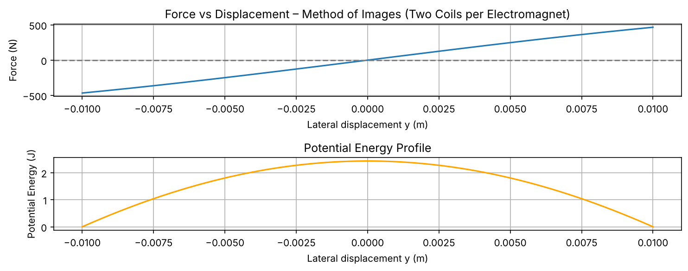
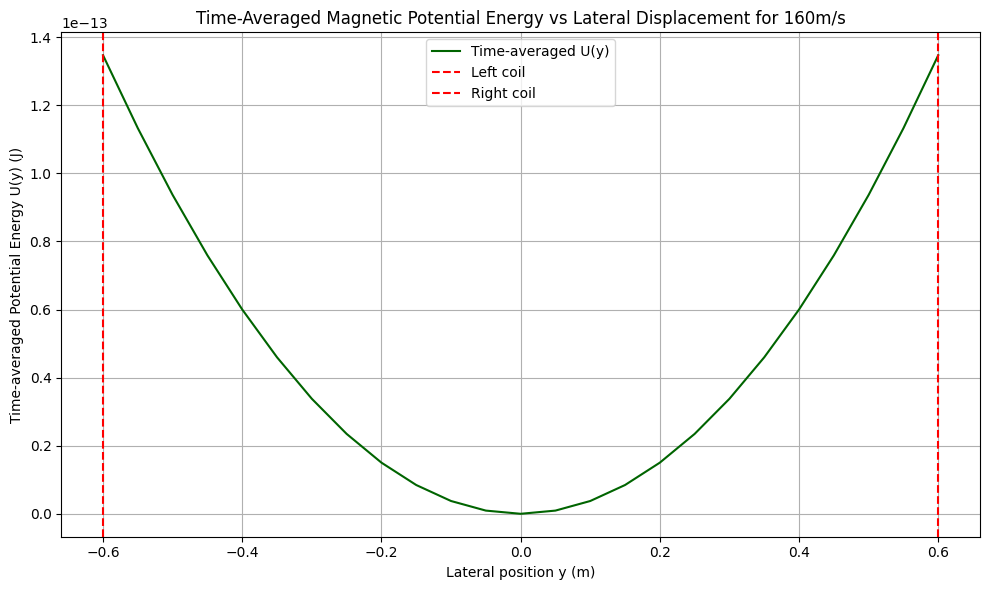

# Lateral Stability of a Maglev Train: EMS vs EDS

**PHY204 Classical Electrodynamics · École Polytechnique (Bachelor of Science) · Spring 2025**

Why does a magnetically levitated train stay centred on its guideway? This project compares the lateral stability of the two main Maglev technologies:

- **EMS (Electromagnetic Suspension):** attractive electromagnets (Transrapid style)
- **EDS (Electrodynamic Suspension):** superconducting magnets that induce currents in figure-8 guideway coils (SCMaglev style)

We combine analytical derivations (magnetic-circuit theory, the method of images, magnetic dipoles, Faraday + Ohm) with Python simulations of the lateral **force** and **potential-energy** profiles.

📄 **[Read the full report (PDF, 43 pages)](report/Maglev_Lateral_Stability_Report.pdf)**

<p align="center">
  
  <br>
  <em>Left: <b>EMS</b>. The potential energy has a <b>maximum</b> at the centre, so the equilibrium is unstable. Right: <b>EDS</b> at 160 m/s. The time-averaged potential energy has a <b>minimum</b> at the centre, so the train is passively stable.</em>
</p>

## Key results

| System | Model | Lateral equilibrium | Consequence |
|---|---|---|---|
| **EMS** | Magnetic-circuit method | Unstable: energy maximum at y = 0 | Needs **active feedback control** |
| **EMS** | Method of images, 1 coil per electromagnet | Unstable | Same |
| **EMS** | Method of images, 2 opposite-current coils | Unstable: the restoring force has the wrong sign | Same |
| **EDS** | Moving dipoles + induced currents in figure-8 guideway coils | **Stable**: the time-averaged energy well is centred at y = 0 | **Passive** guidance at high speed |

These match how real systems work: the Transrapid uses gap-control electronics, while the Japanese SCMaglev guides itself passively once it is above its lift-off speed.

## Repository structure

```
├── report/
│   └── Maglev_Lateral_Stability_Report.pdf   # full report: theory, derivations, simulations, code appendix
├── src/
│   ├── EMS_magnetic_circuit.py               # EMS: magnetic-circuit model
│   ├── EMS_method_of_images.py               # EMS: method of images, one coil per electromagnet
│   ├── EMS_two_coils_sim.py                  # EMS: method of images, two opposite-current coils
│   └── EDS_simulation.py                     # EDS: flux, induced current, time-averaged energy vs y
├── notebooks/
│   └── EDS_current_fft_energy.ipynb          # EDS: current, FFT and energy (report section 4.2)
├── figures/                                  # figures generated by the scripts
└── requirements.txt
```

## Run the simulations

```bash
pip install -r requirements.txt
python src/EMS_magnetic_circuit.py
python src/EMS_method_of_images.py
python src/EMS_two_coils_sim.py
python src/EDS_simulation.py        # ~5 s
```

Each script displays its plot and also saves it in `figures/`.

## Team

- Julia Benhamou
- [Jules Fréalle](https://github.com/julesFrealle)
- Clément Rauch
- Benjamin Shu

Project carried out for the Classical Electrodynamics course (PHY204) at **École Polytechnique**, France.
